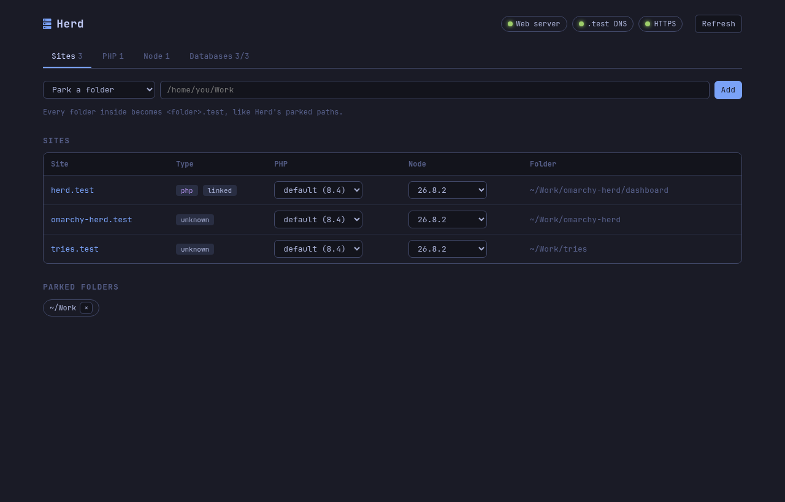
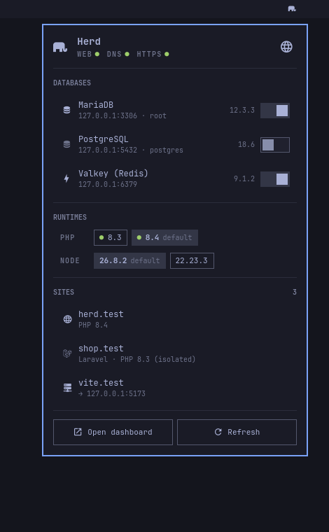
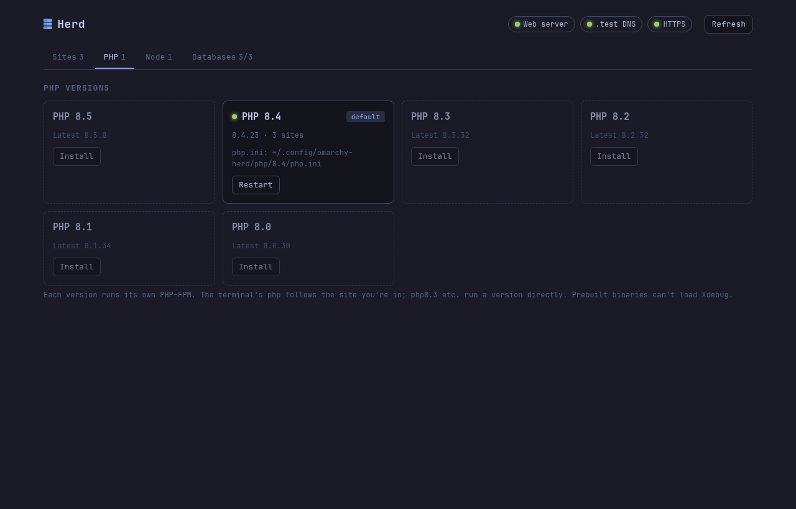

# omarchy-herd

A [Laravel Herd](https://herd.laravel.com)–style local development environment for [Omarchy](https://omarchy.org). No Docker, no containers: PHP, databases and the web server run natively, and you can see and control all of it from a dashboard and the Omarchy bar.



- **`.test` domains for every project.** Park a folder and each project inside is served at `https://<folder>.test`. New folders are picked up automatically. Link single folders, or proxy a name to a dev server such as Vite.
- **PHP 8.0 – 8.5, side by side.** Prebuilt [static-php-cli](https://static-php.dev) binaries install in seconds. Pick a default and pin individual sites to other versions. In the terminal, `php` and Composer follow the project you're in.
- **Node versions per project** through [mise](https://mise.jdx.dev).
- **MariaDB, PostgreSQL and Valkey (Redis)** running as your user: start and stop them without a password, connect with any GUI client.
- **HTTPS that just works**, from a local certificate authority your system and Chrome trust.
- **Visibility**: a dashboard at `https://herd.test` and a bar widget with live status and start/stop toggles.

> omarchy-herd is a community project. It isn't affiliated with Laravel, Laravel Herd or Omarchy.

**Documentation:** the [wiki](https://github.com/andidst/omarchy-herd/wiki) has recipes, the full CLI reference, troubleshooting and how it all works. **Contributing:** see [CONTRIBUTING.md](CONTRIBUTING.md).

## Requirements

- Omarchy (Arch Linux with Hyprland, NetworkManager and systemd-resolved, as Omarchy ships them)
- x86_64
- `jq`, `curl`, `mise` and `git` (Omarchy includes them)

## Install

```bash
git clone https://github.com/andidst/omarchy-herd.git ~/Work/omarchy-herd
~/Work/omarchy-herd/install.sh
```

The installer asks for your password once. It installs `caddy`, `dnsmasq`, `mariadb`, `postgresql` and `valkey` from the Arch repositories and sets up the always-on pieces described in [How it works](#how-it-works). Everything else runs as your user. Then it:

- downloads PHP 8.4 as the default
- parks `~/Work` if it exists
- starts MariaDB, PostgreSQL and Valkey
- adds the Herd icon to the Omarchy bar
- adds one `PATH` line to `~/.bashrc` (open a new terminal afterwards)

Check everything with:

```bash
omarchy-herd doctor
```

Restart Chrome once so it picks up the new certificate authority, then open **https://herd.test**.

## Using it

### Sites

```bash
omarchy-herd park ~/Work              # every folder in ~/Work → https://<folder>.test
omarchy-herd link shop ~/code/shop    # one folder anywhere → https://shop.test
omarchy-herd proxy app 5173           # https://app.test → a dev server on port 5173
omarchy-herd sites                    # list everything with PHP and Node versions
omarchy-herd open shop                # open in the browser
```

Sites with a `public/` folder (Laravel, Symfony) are served from it; others from the project root. Dotfiles such as `.env` and `.git` are never served. Every site answers on both `http://` and `https://`.

### PHP

```bash
omarchy-herd php available            # versions you can install
omarchy-herd php install 8.3
omarchy-herd php default 8.4          # used by sites and the terminal
omarchy-herd isolate 8.3 shop         # pin shop.test (and `php` inside its folder) to 8.3
omarchy-herd unisolate shop
omarchy-herd php update               # newest patch release of every installed version
```

In a terminal, `php` picks the version of the site you're in, so `composer install` and `php artisan` use the right one. `php8.3`, `php8.4` and so on run a version directly. Settings live in `~/.config/omarchy-herd/php/<version>/php.ini`; omarchy-herd never overwrites them. Apply changes with `omarchy-herd restart php-8.4`.

### Node

```bash
omarchy-herd node available
omarchy-herd node install 22
omarchy-herd node default 22
omarchy-herd node use 20 shop         # writes shop's mise.local.toml
omarchy-herd node reset shop
```

Consider adding `mise.local.toml` to your global gitignore.

### Databases

```bash
omarchy-herd services                 # status and connection details
omarchy-herd start mariadb            # or postgres, valkey, databases, all
omarchy-herd stop postgres            # stays stopped after the next login
```

| Database | Host | Port | User | Password |
|---|---|---|---|---|
| MariaDB (MySQL) | 127.0.0.1 | 3306 | root | *(empty)* |
| PostgreSQL | 127.0.0.1 | 5432 | postgres | *(empty)* |
| Valkey (Redis) | 127.0.0.1 | 6379 | – | – |

Browse them with any GUI client, for example [Beekeeper Studio](https://www.beekeeperstudio.io) (`omarchy pkg aur add beekeeper-studio-bin`), [DBeaver](https://dbeaver.io) (`omarchy pkg add dbeaver`) or TablePlus. The dashboard's Databases tab has copy-ready `.env` snippets.

### Dashboard and bar widget

| | |
|---|---|
|  | The **bar widget** shows health at a glance (the icon turns red when something is down), lets you start and stop databases, and opens sites. Right-click opens the dashboard. |

The **dashboard** at https://herd.test does everything the CLI does: park, link and proxy sites, switch a site's PHP or Node version, install and remove versions, and start or stop databases.



### Everything else

```bash
omarchy-herd status                   # everything at a glance
omarchy-herd logs <site|caddy|mariadb|postgres|valkey|php-8.4>
omarchy-herd help
```

Every command accepts `--json`; the dashboard and bar widget use that interface.

## How it works

| Piece | What runs | Where |
|---|---|---|
| Web server | Caddy, as a sandboxed system service running as you, bound to `127.0.0.1` and `::1` on ports 80/443 | `omarchy-herd-caddy.service` |
| `.test` DNS | dnsmasq on `127.0.0.153`, answering only `*.test` | `omarchy-herd-dns.service`, `/etc/omarchy-herd/dnsmasq.conf` |
| `.test` routing | A dummy NetworkManager connection (`herd0`) whose only DNS route is `~test` | `nmcli connection show omarchy-herd` |
| HTTPS | Caddy's local certificate authority, trusted system-wide and in Chrome's NSS database | `~/.local/share/caddy/pki` |
| PHP | One PHP-FPM user service per version, on a Unix socket | `omarchy-herd-php@<version>.service` |
| Databases | User services with data in your home folder | `omarchy-herd-{mariadb,postgres,valkey}.service` |
| New-folder detection | A systemd path unit watching parked folders | `omarchy-herd-watch.path` |

Why these choices:

- **`.test`** is reserved for testing ([RFC 6761](https://www.rfc-editor.org/rfc/rfc6761)), so it never collides with real domains, and browsers don't force HTTPS on it the way they do for `.dev`.
- **A dedicated DNS route.** systemd-resolved sends a domain's lookups to the DNS server of the link that claims it (route-only domains, see ["Protocols and Routing" in systemd-resolved(8)](https://www.freedesktop.org/software/systemd/man/latest/systemd-resolved.service.html)). Putting `~test` on its own dummy link means `.test` is the only thing dnsmasq ever sees, and `omarchy dns` (which rewrites the global resolver settings) can't break it.
- **Caddy** issues certificates from its [local CA](https://caddyserver.com/docs/automatic-https#local-https) and reloads without dropping connections. It runs as you so it can read your projects and reach PHP-FPM, with only `CAP_NET_BIND_SERVICE` and write access to its own certificate, log and socket folders.
- **Static PHP builds** are what [Herd ships too](https://beyondco.de/blog/announcing-laravel-herd): self-contained binaries from static-php-cli with the common extensions built in (including `pdo_mysql`, `pdo_pgsql`, `pdo_sqlite`, `intl`, `gd`, `redis`, `opcache`), so there's nothing to compile.
- **User services** for PHP and databases mean no password prompts and no files owned by root in your home folder.

### Files

| Path | Contents |
|---|---|
| `~/.config/omarchy-herd/config.json` | Parked folders, links, proxies, per-site PHP |
| `~/.config/omarchy-herd/php/<version>/php.ini` | Your PHP settings |
| `~/.local/share/omarchy-herd/` | PHP binaries, database data, sockets, logs, generated Caddyfile |

## Security model

omarchy-herd is built for a **single-user development machine**. Know what it does before you install it:

- **Nothing is reachable from the network.** Caddy, PHP-FPM, the databases and dnsmasq listen only on loopback addresses or Unix sockets.
- **Databases have no passwords**, like Herd and DBngin. Any program running on this machine can connect to them. Don't keep production data in them.
- **Other local accounts can reach your sites.** Loopback ports aren't per-user, so on a shared machine another user could load your sites and the dashboard. Don't use omarchy-herd on multi-user systems.
- **Root only touches system files.** The one-time root step never creates, changes or copies anything inside your home folder: it checks that the folders the web server writes to are real directories you own (no symlinks), and reads the certificate authority as you.
- **The dashboard can change your setup.** Each change runs as a short-lived background service, so it completes even if the page reloads. The dashboard only accepts requests addressed to `herd.test` from its own page: it checks the `Host`, `Origin` and `Sec-Fetch-Site` headers, requires a custom header on every change (which other websites can't send without a CORS preflight it never answers), sends a strict Content Security Policy and can't be framed. It runs the same CLI you do, with every argument validated against an allow-list.
- **A local certificate authority is trusted system-wide.** Its private key lives in `~/.local/share/caddy/pki`; anything able to read that folder could issue certificates your browser trusts. That is the same trade-off Herd, Valet and mkcert make. `omarchy-herd uninstall` removes the trust.
- **PHP binaries come from static-php-cli's download server** (`dl.static-php.dev`) over HTTPS. The project doesn't publish checksums or signatures, so omarchy-herd records the SHA-256 of what it installed in `~/.local/share/omarchy-herd/php/<version>/SHA256SUMS` for later auditing.
- **What gets served.** omarchy-herd refuses to park or link `/`, your home folder or hidden folders. In project roots without a `public/` folder, dotfiles are hidden but every other file is served, as with any static web server.

Found a security problem? Please report it privately, as described in [SECURITY.md](SECURITY.md), rather than opening a public issue.

## Troubleshooting

| Problem | Fix |
|---|---|
| Something isn't working | `omarchy-herd doctor` points at the failing piece |
| `https://` shows a certificate warning | Restart the browser. Firefox keeps its own store: import `~/.local/share/caddy/pki/authorities/local/root.crt` under Settings → Certificates |
| A new project has no domain | It should appear within seconds; force it with `omarchy-herd apply` |
| `php` in the terminal is the system PHP | Open a new terminal, or run `source ~/.bashrc` |
| A site returns 502 | Its PHP version isn't running: `omarchy-herd start php-8.4` |
| A database won't start | `omarchy-herd logs mariadb` (or `postgres`, `valkey`). Something else may already use the port |
| `.test` names don't resolve | `resolvectl status herd0` should show DNS server `127.0.0.153` and DNS domain `~test`; re-apply with `omarchy-herd setup --system` |

## Upgrade

```bash
git -C ~/Work/omarchy-herd pull
omarchy-herd setup
```

`setup` is safe to re-run. When an upgrade changes the root-owned pieces (the web server and DNS services), it asks for your password once to re-apply them.

## Uninstall

```bash
omarchy-herd uninstall           # removes services, DNS route, CA trust, PATH line and bar icon
omarchy-herd uninstall --purge   # also deletes PHP builds, settings and ALL database data
```

The packages stay installed; remove them with `sudo pacman -Rns caddy dnsmasq mariadb postgresql valkey`.

## Limitations

- Static PHP can't load extensions at runtime, so there's no Xdebug. Use the system PHP (`/usr/bin/php`) with Arch's `xdebug` package when you need step debugging.
- MariaDB stands in for MySQL, which Arch doesn't package. It works with Laravel's `mysql` and `mariadb` drivers.
- The TLD is fixed to `.test`.
- Sites under `/tmp` can't be served, because the web server has a private `/tmp`.

## Contributing

Contributions are welcome. [CONTRIBUTING.md](CONTRIBUTING.md) covers the development setup, the rules that keep installs from breaking, and how pull requests are reviewed. Report security problems privately, as described in [SECURITY.md](SECURITY.md). Everyone taking part follows the [code of conduct](CODE_OF_CONDUCT.md).

```
bin/omarchy-herd        CLI entry point
lib/                    CLI modules: sites, php, node, services, setup, uninstall
setup/                  root-owned parts of setup and uninstall
dashboard/              the herd.test dashboard (plain PHP, no dependencies)
plugin/                 the Omarchy bar widget (Quickshell/QML)
wiki/                   source of the GitHub wiki, published on merge
```

## License

[MIT](LICENSE)
